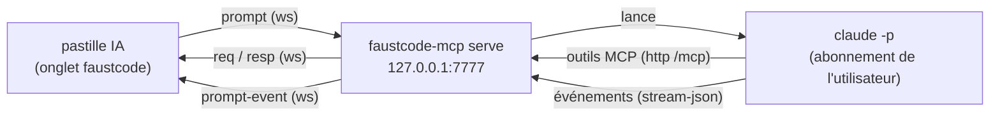

::: toc+
- **Objet** — ce que l'utilisateur fait, et ce que l'application ne fait pas.
- **Principes** — les invariants de la conception.
- **Architecture** — le pont devient un service local, MCP sur HTTP.
- **Protocole** — les nouveaux messages de la websocket.
- **Lancement de l'agent** — la ligne de commande de Claude Code et la traduction de ses événements.
- **Contexte et consigne** — ce que l'agent sait de l'application.
- **Sécurité** — modèle de menace et règles.
- **Interface** — la pastille IA, la dictée.
- **Extension aux autres outils** — faustmodular, faustdaw.
- **Hors périmètre, phases, critères d'acceptation.**
:::

# Objet

Aujourd'hui, Claude pilote faustcode depuis un client MCP (Claude Code dans un terminal ou VS Code, Claude Desktop) : le client lance `faustcode-mcp`, qui relaie les appels d'outils à l'onglet par `ws://127.0.0.1:7777/ws`. Il faut donc quitter l'application pour lui parler.

Le **canal prompt** permet de taper ou de dicter une requête **dans l'application elle-même** (« ajoute un vibrato de 5 Hz », « pourquoi ce code ne compile pas ? », « fais-moi entendre le spectre à 440 Hz ») et de voir la réponse s'afficher à côté du code.

L'application **n'appelle aucun modèle**. Elle transmet la requête au pont local, qui la confie à **Claude Code installé sur la machine de l'utilisateur**, connecté avec son abonnement. Claude Code agit sur l'application par les **mêmes outils MCP** qu'aujourd'hui, et le pont renvoie sa réponse en flux.



# Principes

P-1
: **Aucun secret dans le navigateur.** L'application ne détient ni clé API ni jeton Anthropic. L'abonnement n'est utilisé que par Claude Code, qui lit lui-même ses identifiants (connexion faite une fois par `claude`, puis `/login`).

P-2
: **Un seul chemin d'action : les outils MCP.** L'agent lancé par le canal n'a accès à aucun outil intégré de Claude Code (ni shell, ni fichiers, ni web) ; il ne peut faire que ce que les outils de `tools.json` permettent. Il n'y a pas de chemin privilégié : un agent externe (VS Code) et l'agent du canal passent par le même serveur MCP.

P-3
: **Tout est visible et réversible.** Chaque appel d'outil est affiché dans la pastille. Dans faustcode, une modification de code crée une nouvelle session (identifiée par son sha1) : la précédente reste accessible. Dans faustmodular, une requête forme une seule étape d'annulation (§ Extension).

P-4
: **Désactivé par défaut.** Le canal n'existe que si le pont est lancé avec `--prompt`. Sans cette option, le comportement actuel est inchangé.

P-5
: **Usage personnel.** Le canal pilote le Claude Code de l'utilisateur, sur sa machine, avec son compte ; le projet ne distribue ni identifiants ni accès au modèle. Anthropic demande que les produits tiers passent par des clés API et non par la connexion claude.ai : avant toute diffusion du canal au-delà d'un usage personnel, faire vérifier ce point au regard des conditions en vigueur.

# Architecture

## Deux modes du pont

Aujourd'hui, `faustcode-mcp` est lancé **par** un client MCP et parle MCP sur stdio ; il vit tant que ce client vit. Le canal prompt a besoin d'un pont qui existe **sans** client MCP. D'où un second mode.

| Mode | Lancement | MCP | Canal prompt | Durée de vie |
| :-- | :-- | :-- | :-- | :-- |
| `stdio` (actuel, défaut) | par le client MCP | stdio, et HTTP `/mcp` | si `--prompt` | celle du client |
| `serve` (nouveau) | `faustcode-mcp serve` dans un terminal, ou au démarrage de session | HTTP `/mcp` | si `--prompt` | indépendante |

Dans les deux modes, le même port (défaut 7777, toujours sur `127.0.0.1`, SC-1) sert :

- `/ws` — la websocket de l'onglet (inchangée, plus les messages du canal) ;
- `/mcp` — MCP sur HTTP (transport « streamable HTTP » de la spécification MCP ; le SDK Go utilisé le fournit, à confirmer à l'implémentation) ;
- `/healthz` — inchangé.

Servir MCP en HTTP résout un conflit : si l'agent lancé par le canal démarrait son propre `faustcode-mcp` en stdio, celui-ci voudrait lui aussi le port 7777. En HTTP, l'agent du canal et un Claude Code externe se connectent **au même pont**, qui reste le seul propriétaire de l'onglet.

Un Claude Code externe peut alors se brancher sur le service plutôt que de lancer le binaire :

```bash
claude mcp add --transport http faustcode http://127.0.0.1:7777/mcp --header "Authorization: Bearer <jeton>"
```

## Options du pont

| Option | Défaut | Rôle |
| :-- | :-- | :-- |
| `serve` (sous-commande) | — | mode service, sans stdio |
| `--prompt` | désactivé | active le canal prompt |
| `--claude <chemin>` | `claude` dans le `PATH` | exécutable de Claude Code (un faux exécutable pour les tests) |
| `--model <modèle>` | celui de Claude Code | modèle passé à l'agent |
| `--allow-origin <origine>` | voir SP-2 | origine web autorisée en plus (répétable) |
| `--token-file <chemin>` | `~/.faustcode/token` | jeton d'appariement (SP-3) |
| `--prompt-timeout <durée>` | `10m` | durée maximale d'une requête |

Au démarrage avec `--prompt`, le pont exécute `claude --version` ; en cas d'échec, le canal est annoncé indisponible (`claude_not_found`) mais les outils MCP restent servis.

# Protocole

Les messages existants (`hello`, `ready`, `req`, `resp`, `ping`, `pong`) sont inchangés. Le canal ajoute des champs facultatifs et quatre types de messages ; un onglet ou un pont qui ne les connaît pas les ignore, la compatibilité est donc ascendante dans les deux sens.

## Négociation

- `hello` (pont → onglet) reçoit `features: ["prompt"]` si le canal est actif, et `promptStatus` : `"ok"`, `"claude_not_found"` ou `"unauthorized"` (jeton absent ou faux, SP-3).
- `ready` (onglet → pont) reçoit `features: ["prompt"]` si l'onglet sait afficher la pastille, et `token` (champ existant de SC-4, réutilisé).

La pastille n'est affichée que si les deux côtés déclarent `prompt`.

## Messages

| Sens | `kind` | Champs | Rôle |
| :-- | :-- | :-- | :-- |
| onglet → pont | `prompt` | `id`, `text`, `conversation?`, `context?` | nouvelle requête |
| onglet → pont | `prompt-cancel` | `id` | interrompre la requête |
| onglet → pont | `prompt-reset` | `conversation` | oublier une conversation |
| pont → onglet | `prompt-event` | `id`, `event`, champs selon `event` | déroulement d'une requête |

- `id` : identifiant de la requête, tiré par l'onglet (UUID).
- `conversation` : identifiant de session Claude Code rendu par l'événement `started` ; s'il est fourni, la requête continue cette conversation (`--resume`), sinon elle en commence une.
- `context` : objet décrit au § Contexte.

Événements (`prompt-event.event`) :

| `event` | Champs | Sens |
| :-- | :-- | :-- |
| `started` | `conversation` | l'agent a démarré |
| `text` | `delta` | morceau de texte de la réponse, à concaténer |
| `tool` | `tool`, `phase` (`call` ou `result`), `ok?` | appel d'outil MCP et son issue |
| `done` | `text`, `conversation`, `durationMs` | fin normale ; `text` est la réponse complète |
| `error` | `code`, `message` | fin en erreur |

Codes d'erreur : `prompt_disabled`, `unauthorized`, `claude_not_found`, `not_logged_in`, `busy`, `cancelled`, `timeout`, `agent_error`.

## Règles

PC-1
: Une seule requête à la fois par pont. Une requête reçue pendant une autre reçoit `error/busy`.

PC-2
: Pendant une requête, le pont envoie à l'onglet les `req` des outils appelés par l'agent, entrelacés avec les `prompt-event` : c'est le fonctionnement MCP habituel.

PC-3
: Si l'onglet se déconnecte pendant une requête, l'agent est interrompu (comme `prompt-cancel`). Si un nouvel onglet remplace l'ancien (code 4001, PR-5), la requête en cours est interrompue aussi.

PC-4
: `prompt-cancel` envoie SIGINT à l'agent, puis SIGKILL au bout de 3 s ; l'événement final est `error/cancelled`. Les actions déjà faites restent (et s'annulent comme les autres, P-3).

PC-5
: Une requête dépassant `--prompt-timeout` est interrompue comme en PC-4, avec `error/timeout`.

# Lancement de l'agent

## Ligne de commande

Pour chaque requête, le pont lance un processus (version 1 : un processus par requête, la conversation étant reprise par `--resume`) :

```bash
claude -p \
  --output-format stream-json --verbose --include-partial-messages \
  --mcp-config '{"mcpServers":{"faustcode":{"type":"http","url":"http://127.0.0.1:7777/mcp","headers":{"Authorization":"Bearer <jeton>"}}}}' \
  --strict-mcp-config \
  --tools "" \
  --allowedTools "mcp__faustcode" \
  --permission-prompts none \
  --append-system-prompt "<consigne>" \
  [--model <modèle>] [--resume <conversation>]
```

Le texte de la requête, précédé du contexte (§ Contexte), est écrit sur l'entrée standard.

| Option | Raison |
| :-- | :-- |
| `-p` + `stream-json` + `--verbose` + `--include-partial-messages` | exécution non interactive, événements ligne par ligne, texte en flux |
| `--mcp-config` + `--strict-mcp-config` | le serveur faustcode du pont, et **aucun autre** serveur MCP de la configuration de l'utilisateur |
| `--tools ""` | aucun outil intégré (ni Bash, ni fichiers, ni web) : P-2 |
| `--allowedTools "mcp__faustcode"` | tous les outils du serveur faustcode sont autorisés sans demande |
| `--permission-prompts none` | ce qui demanderait une autorisation est refusé, puisque personne ne peut répondre |
| `--append-system-prompt` | consigne propre au canal (§ Contexte) |

Le processus est lancé dans un répertoire de travail dédié et vide (`~/.faustcode/agent/`) : en mode `-p`, Claude Code saute le dialogue de confiance du répertoire et chargerait sinon le `CLAUDE.md` d'un projet quelconque.

L'option `--bare` **ne doit pas** être utilisée : dans ce mode, Claude Code n'accepte que `ANTHROPIC_API_KEY` et ignore la connexion par abonnement.

## Traduction des événements

Chaque ligne de la sortie `stream-json` est un objet JSON ; le pont en tire les `prompt-event` :

| Sortie de Claude Code | `prompt-event` |
| :-- | :-- |
| `{"type":"system","subtype":"init","session_id":…}` | `started` (`conversation` = `session_id`) |
| `stream_event` portant un `text_delta` | `text` |
| message `assistant` contenant un bloc `tool_use` | `tool` / `call` (nom sans le préfixe `mcp__faustcode__`) |
| message `user` contenant un `tool_result` | `tool` / `result` (`ok` = absence de `is_error`) |
| `{"type":"result", "is_error": false, …}` | `done` |
| `{"type":"result", "is_error": true, …}` ou sortie non nulle | `error` (`not_logged_in` si le message signale une authentification manquante, `agent_error` sinon) |

Les autres lignes sont ignorées. Le format exact de ces événements est celui de Claude Code et de l'Agent SDK ; les tests s'appuient sur des sorties enregistrées (§ Critères), à renouveler quand Claude Code évolue.

# Contexte et consigne

**Consigne** (`--append-system-prompt`, fixe pour une conversation) :

> Tu pilotes l'application faustcode ouverte dans le navigateur de l'utilisateur, uniquement par les outils `mcp__faustcode__*`. Après une modification de code, vérifie qu'elle compile (`get_errors`) et dis-le. Réponds brièvement, dans la langue de la requête. Si la requête est ambiguë, pose une question plutôt que d'agir.

**Contexte** (champ `context` du message `prompt`, variable à chaque requête) : `app` (nom et version), `view` (vue active), `session` (sha1 et nom de fichier de la session active), `selection?` (texte sélectionné dans l'éditeur, tronqué à 4 ko).

Le pont place le contexte **dans le message utilisateur**, en tête et entre balises, et non dans la consigne. Claude Code enregistre la consigne au premier échange d'une conversation et la réutilise telle quelle ensuite : un contexte mis dans la consigne serait figé à la première requête.

```text
<context app="faustcode 0.13.2" view="dsp" session="3f2a… osc.dsp">
<selection>os.osc(440)</selection>
</context>
remplace cet oscillateur par un dent de scie antialiasée
```

# Sécurité

## Modèle de menace

Le pont n'écoute que sur `127.0.0.1` (SC-1) et accepte aujourd'hui toute origine (`CheckOrigin` renvoie vrai) : le seul risque était qu'une page tierce usurpe l'onglet et reçoive des appels d'outils. Avec le canal, une page tierce ouverte dans le navigateur pourrait **lancer un agent** sur l'abonnement de l'utilisateur et agir sur l'application. Et `/mcp` en HTTP expose le pont au *DNS rebinding* (une page dont le domaine résout vers 127.0.0.1). Les règles suivantes ne s'appliquent que si `--prompt` ou `serve` est actif ; le mode stdio sans `--prompt` reste tel quel.

SP-1
: **Activation explicite** : `--prompt` (P-4).

SP-2
: **Origines autorisées** sur `/ws` : `https://orlarey.github.io`, `http://localhost:<port>`, `http://127.0.0.1:<port>`, plus celles de `--allow-origin`. Une connexion d'une autre origine est refusée. L'origine est fixée par le navigateur et ne peut pas être falsifiée par une page. Une origine couvre tout un hôte : toutes les applications de `orlarey.github.io` (faustcode, faustmodular, markpage…) partagent la même, ce qui est voulu.

SP-3
: **Jeton d'appariement obligatoire pour le canal.** Au premier lancement, le pont tire un jeton aléatoire de 128 bits, l'écrit dans `~/.faustcode/token` (droits 0600) et l'affiche dans le terminal. L'utilisateur le colle une fois dans le panneau « Setup MCP » de l'application, qui le garde dans le `localStorage` de l'origine et l'envoie dans `ready.token`. Sans jeton valide, les outils fonctionnent comme aujourd'hui, mais `promptStatus` vaut `unauthorized` et toute requête reçoit `error/unauthorized`.

SP-4
: **`/mcp` protégé** : l'en-tête `Host` doit être `127.0.0.1:<port>` ou `localhost:<port>` (contre le *DNS rebinding*) ; une requête portant un en-tête `Origin` hors de SP-2 est refusée ; `Authorization: Bearer <jeton>` est exigé.

SP-5
: **Agent confiné** : pas d'outils intégrés, un seul serveur MCP, aucune demande d'autorisation possible, répertoire de travail vide (§ Lancement). Le pire qu'il puisse faire est ce que permettent les outils de `tools.json` : modifier ou supprimer des sessions, jouer du son, écrire des WAV dans le répertoire de rendu.

SP-6
: **Injection de consignes.** Des résultats d'outils (documentation des bibliothèques, code reçu par un lien partagé) peuvent contenir du texte qui se présente comme une consigne. Les conséquences sont bornées par SP-5, et chaque appel d'outil est affiché (P-3).

# Interface

## La pastille IA

- Une pastille **IA** dans l'en-tête, à côté de la pastille MCP, visible seulement si le canal est négocié (§ Protocole). Grisée avec une infobulle si `promptStatus` n'est pas `ok` (« lancer `claude` puis `/login` », « coller le jeton du pont »…).
- Un clic (ou un raccourci clavier, à choisir pour ne pas entrer en conflit avec CodeMirror) ouvre un panneau flottant, déplaçable comme l'éditeur flottant :
  - l'historique de la conversation : requêtes, réponses affichées en flux, appels d'outils en lignes compactes (`▸ submit ✓`, `▸ get_errors ✗`) ;
  - un champ de saisie : Entrée envoie, Maj-Entrée passe à la ligne ;
  - pendant une requête, un bouton **Arrêter** (`prompt-cancel`) ;
  - un bouton **Nouvelle conversation** (`prompt-reset`, puis requête sans `conversation`).
- L'identifiant de conversation est gardé dans le `sessionStorage` : il survit à un rechargement, pas à la fermeture de l'onglet.

## Dictée

- **Sans rien développer** : la dictée du système (sur macOS, double appui sur Fn) écrit dans n'importe quel champ, donc dans celui de la pastille.
- **En option** : un bouton micro qui utilise l'API Web Speech (`SpeechRecognition`, préfixée `webkit` dans Chrome), dans la langue du navigateur ; il n'est affiché que si l'API existe. Dans Chrome, la reconnaissance est faite sur les serveurs de Google : l'infobulle du bouton le dit. Le texte dicté remplit le champ, sans l'envoyer : l'utilisateur relit puis valide.

## Un composant partagé

La pastille est un module JavaScript autonome (`webapp/ai-pill.js`), sans dépendance, paramétré par un transport (`send(message)`, `onEvent(callback)`) et par la fonction qui fournit le contexte. Les autres outils de la même origine (faustmodular, faustdaw) l'importent tel quel.

# Extension aux autres outils

Le pont est écrit pour faustcode, mais rien dans le canal ne lui est propre. Pour faustmodular et faustdaw :

- **Une surface MCP par application.** faustmodular devra exposer ses outils : lire la scène (son instantané JSON), ajouter ou supprimer un module, connecter ou déconnecter, régler un paramètre, moduler, éditer le code d'un module. Comme pour faustcode, un contrat `tools.json` partagé entre l'application et le pont.
- **Un pont devenu hub local.** Chaque onglet se présente dans `ready` avec son `app` ; le hub publie un serveur MCP par application (`/mcp/faustcode`, `/mcp/faustmodular`) et route les appels vers l'onglet correspondant. Le message `prompt` porte l'application d'origine, qui choisit la consigne et les outils autorisés ; une requête peut aussi autoriser plusieurs applications (« mets ce code dans un module »).
- **Une requête, une étape d'annulation.** Dans faustmodular, la pastille ouvre un groupe d'historique à `started` et le ferme à `done` ou `error` : tout ce que l'agent a fait s'annule d'un seul Ctrl-Z. Cela demande d'ajouter à `History` une paire `begin()` / `end()` qui suspend l'enregistrement par temporisation.

Ces extensions sont hors de la version 1, mais le protocole est conçu pour les accueillir sans changement incompatible.

# Hors périmètre

- **Mode clé API** : appel direct de l'API Messages depuis le navigateur avec une clé de l'utilisateur. Possible plus tard comme second moteur derrière la même pastille ; il serait facturé séparément de l'abonnement.
- **Confirmation par l'utilisateur** de certains outils (supprimer une session…) : Claude Code peut déléguer les demandes d'autorisation à un outil MCP (`--permission-prompt-tool`) ; la pastille pourrait les afficher. Version ultérieure.
- **Processus persistant** par conversation (`--input-format stream-json`) au lieu d'un processus par requête : à décider selon la latence mesurée.
- Réponse vocale, affichage du quota de l'abonnement, plusieurs utilisateurs, mobile.

# Phases

1. **Mode `serve` et `/mcp` en HTTP**, avec jeton, contrôle de `Host` et d'origine. Utile seul : un Claude Code externe se branche sur un service au lieu de lancer le binaire.
2. **Canal côté pont** : messages, lancement de l'agent, traduction des événements, annulation, délai. Testé avec un faux `claude` (`--claude`).
3. **Pastille dans faustcode**, panneau Setup MCP étendu au jeton.
4. **Dictée** par l'API Web Speech.
5. **Hub et faustmodular** : surface MCP, routage par application, groupe d'annulation.

# Critères d'acceptation

- **Tests Go du pont** :
  - origine hors liste refusée sur `/ws` ; `Host` étranger, `Origin` hors liste ou jeton absent refusés sur `/mcp` ;
  - requête sans jeton valide → `unauthorized` ; deuxième requête simultanée → `busy` ;
  - ligne de commande construite exactement (présence de `--tools ""`, `--strict-mcp-config`, `--permission-prompts none` ; absence de `--bare`) ;
  - traduction `stream-json` → `prompt-event` sur des sorties enregistrées de Claude Code (texte en flux, appel d'outil réussi, appel en erreur, erreur d'authentification) ;
  - annulation et délai : le processus est tué, l'événement final est émis, le pont accepte la requête suivante.
- **Test de bout en bout avec un faux `claude`** (script qui rejoue une sortie enregistrée et appelle réellement `/mcp`) : la requête tapée dans la pastille produit l'appel `submit` dans l'onglet, une nouvelle session compilée, et la réponse affichée en flux.
- **Essai manuel avec le vrai Claude Code** : « ajoute un vibrato de 5 Hz au code courant » produit une nouvelle session qui compile ; « Arrêter » interrompt une requête longue ; le délai jusqu'au premier texte affiché est mesuré et noté.
