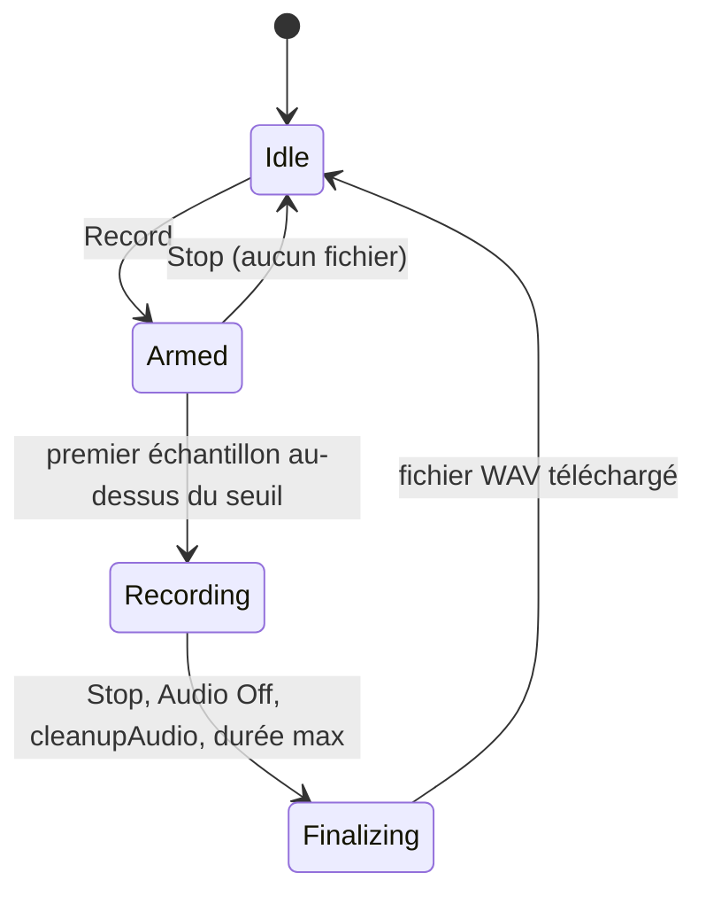

::: toc+
- **Objet** — ce que la fonction apporte et pour qui.
- **Scénario d'utilisation** — le parcours de l'utilisateur, de l'armement au fichier.
- **Comportement** — états, déclenchement, arrêt, événements qui terminent l'enregistrement.
- **Signal enregistré** — point de captation, canaux, fréquence d'échantillonnage.
- **Fichier produit** — format WAV, conversion des échantillons, nom, téléchargement.
- **Implémentation suggérée** — points d'ancrage dans le code existant.
- **Hors périmètre** — ce que cette version ne fait pas.
- **Critères d'acceptation** — ce qui doit être vérifié avant de livrer.
:::

# Objet

faustcode sait rendre un DSP hors ligne pour l'IA (`render_audio`, `detail: "wav"`), mais un utilisateur humain n'a aucun moyen de garder une trace de ce qu'il joue. La fonction **Record** enregistre, dans la vue Run, le son produit en temps réel pendant que l'utilisateur manipule les paramètres (sliders, clavier MIDI, Orbit UI), puis crée automatiquement un fichier WAV.

C'est un enregistrement d'**interprétation** : il capte les gestes, il n'est pas déterministe. Il ne remplace pas `render_audio`, qui reste l'outil du rendu reproductible.

::: important [Priorité]
Indispensable pour le workshop IEEE IS2 du 30 octobre 2026 : à implémenter immédiatement, avant tout autre développement.
:::

# Scénario d'utilisation

1. L'utilisateur appuie sur **Record** : l'enregistreur est **armé** et attend du son.
2. Il joue avec les paramètres du programme. Au premier son, l'enregistrement **démarre**.
3. Il arrête de jouer, laisse le son s'éteindre, puis appuie sur **Stop**.
4. Un fichier WAV est **créé et téléchargé** automatiquement.

# Comportement

## Bouton et états

Un bouton **Record** est ajouté dans la barre d'en-tête de la vue Run (`.run-header-controls`), à côté du bouton **Audio**. Il n'est actif que lorsque l'audio est en marche (`Audio On`).

| État | Libellé du bouton | Affichage |
| :-- | :-- | :-- |
| Idle | `● Rec` | — |
| Armed | `● Armed` (clignotant) | « en attente de son » |
| Recording | `■ Stop` | durée écoulée et niveau crête |
| Finalizing | désactivé | « écriture du fichier… » |

Un second appui sur le bouton, en état Armed ou Recording, vaut **Stop**.

## Déclenchement

En état Armed, l'enregistreur observe le signal sans le garder, à l'exception d'un **pré-roll** circulaire. Il passe en Recording au premier échantillon dont la valeur absolue dépasse le **seuil de silence**, sur l'un quelconque des canaux. Le pré-roll est alors placé en tête du fichier, pour ne pas couper une attaque douce dont le début reste sous le seuil.

## Arrêt et fin du fichier

À l'arrêt, le silence final est retiré : le fichier se termine au dernier échantillon au-dessus du seuil, augmenté d'une **marge de fin**. Les queues de réverbération et les extinctions lentes, même très faibles, sont donc conservées tant qu'elles dépassent le seuil.

Si l'enregistreur est arrêté en état Armed, aucun fichier n'est créé.

## Événements qui terminent l'enregistrement

En état Recording, chacun des événements suivants termine l'enregistrement **et écrit le fichier**, avec le même traitement que **Stop** :

- appui sur **Stop** ;
- passage à **Audio Off** : ce bouton débranche seulement la sortie, le DSP continue de calculer ; on considère que l'utilisateur ne veut plus enregistrer ce qu'il n'entend plus ;
- appel de `cleanupAudio()` : recompilation, changement de session, changement de mode polyphonique, sortie de la vue Run ;
- atteinte de la **durée maximale**.

En état Armed, ces mêmes événements ramènent simplement à Idle.

## Constantes

| Constante | Valeur | Rôle |
| :-- | :-- | :-- |
| Seuil de silence | −90 dBFS (≈ 3,2 × 10⁻⁵) | déclenchement et coupure du silence final |
| Pré-roll | 50 ms | conservé avant le premier échantillon au-dessus du seuil |
| Marge de fin | 100 ms | conservée après le dernier échantillon au-dessus du seuil |
| Durée maximale | 30 min | protège la mémoire du navigateur |

# Signal enregistré

Point de captation
:   La sortie de `dspNode`, branchée **en parallèle** de la chaîne existante `dspNode → analyser → gain → destination`. On enregistre le signal exact calculé par Faust, indépendamment du gain de sortie.

Canaux
:   Toutes les sorties du DSP : 1, 2 ou N canaux, dans l'ordre des sorties Faust.

Fréquence d'échantillonnage
:   Celle de l'`AudioContext` (`audioContext.sampleRate`), écrite telle quelle dans l'en-tête. **Aucun rééchantillonnage.** En pratique 48 kHz sur la plupart des Mac, mais 44,1 kHz est possible selon le périphérique de sortie.

Mémoire
:   Les blocs sont accumulés en Float32 côté thread principal, soit ≈ 23 Mo par minute en stéréo à 48 kHz ; la durée maximale borne l'occupation à ≈ 700 Mo.

# Fichier produit

Format
:   WAV PCM entier **24 bits** signé, little-endian, entrelacé. En-tête `WAVE_FORMAT_PCM` (1) jusqu'à 2 canaux, `WAVE_FORMAT_EXTENSIBLE` au-delà.

Conversion
:   Chaque échantillon Float32 `x` est borné à [−1, 1], puis converti en `round(x × 8 388 607)`. Aucun dither n'est nécessaire en 24 bits.

Écrêtage
:   Les échantillons tels que |x| > 1 sont comptés. S'il y en a, un message l'indique à la fin de l'enregistrement (nombre d'échantillons et pourcentage).

Nom
:   `<nom-de-session>-AAAAMMJJ-HHMMSS.wav`, où `<nom-de-session>` est le `filename` de la session active sans l'extension `.dsp`, et l'horodatage celui du début de l'enregistrement (heure locale).

Téléchargement
:   Automatique, par `Blob` + `URL.createObjectURL` + lien `download`, comme l'export `.faustcode.json` de `io-session.js`. L'URL est révoquée après le téléchargement.

::: note [Pourquoi 24 bits plutôt que 16]
Faust calcule en flottant. En 16 bits sans dither, le bruit de quantification devient audible dans les fins de son très faibles, précisément celles que le scénario veut conserver. Le 24 bits évite d'implémenter un dither, reste lu par tous les outils courants (DAW, Audacity, QuickTime, `scipy.io.wavfile`) et ne coûte qu'une fois et demie la taille du 16 bits.
:::

# Implémentation suggérée

- **Nœud d'enregistrement** : un `AudioWorkletNode` dédié (module `recorder-worklet.js`), avec autant de canaux d'entrée que de sorties du DSP. Le processeur transmet ses blocs Float32 au thread principal par `port.postMessage`, avec transfert des buffers. `MediaRecorder` est exclu : il produit de l'Opus/WebM compressé avec pertes.
- **Logique d'état** (seuil, pré-roll, coupure finale, compteur d'écrêtage) : côté thread principal, dans un module `recorder.js` testable hors navigateur.
- **Encodage** : ajouter `encodePcm24Wav(channels, sampleRate)` à `wav-encode.js`, à côté de `encodeFloat32Wav`.
- **Vue Run** : le bouton dans le gabarit de `views/run.js` (`.run-header-controls`). La finalisation est appelée au début de `cleanupAudio()`, **avant** `dspNode.disconnect()`, et dans le chemin `Audio Off`.
- **Traitement du nœud** : vérifier que le nœud d'enregistrement est bien traité quand la sortie est débranchée ; au besoin, le relier à `destination` par un `GainNode` de gain nul.

# Hors périmètre

- Outil MCP d'enregistrement temps réel : `render_audio` couvre le besoin de l'IA.
- Choix du format (16 bits, Float32) : 24 bits seulement dans cette version.
- Rééchantillonnage vers une fréquence imposée.
- Choix de l'emplacement du fichier (File System Access API) : le navigateur range le fichier dans son dossier de téléchargements.
- Enregistrement de l'entrée audio d'un effet : seule la sortie du DSP est captée.

# Critères d'acceptation

- [ ] **Record** puis jeu, puis **Stop** produit un WAV 24 bits lisible par QuickTime, Audacity et `scipy.io.wavfile`.
- [ ] La fréquence d'en-tête est égale à `audioContext.sampleRate`.
- [ ] Le nombre de canaux est égal au nombre de sorties du DSP (tests en mono, en stéréo et avec 4 sorties).
- [ ] Aucun silence de tête au-delà du pré-roll, aucun silence de queue au-delà de la marge de fin.
- [ ] Une extinction lente (réverbération) n'est pas tronquée tant qu'elle dépasse −90 dBFS.
- [ ] **Stop** en état Armed ne crée aucun fichier.
- [ ] Recompilation, changement de session, **Audio Off** et sortie de la vue Run pendant l'enregistrement écrivent le fichier.
- [ ] Un signal qui dépasse ±1 est signalé à l'arrêt avec le nombre d'échantillons écrêtés.
- [ ] Un enregistrement de 10 min en stéréo ne provoque ni craquement audible ni blocage de l'interface.
